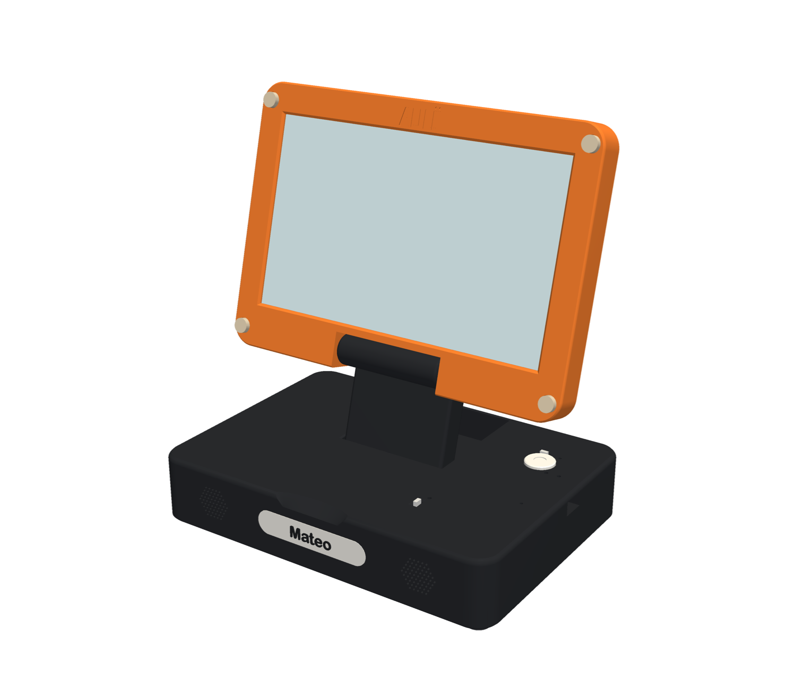
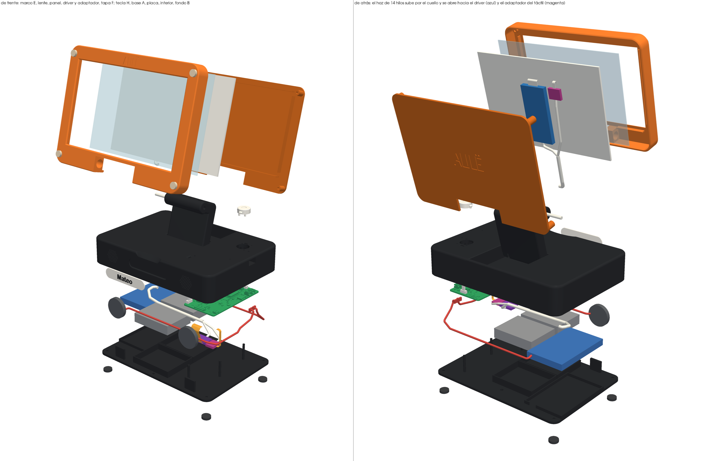

# Capricorn Hardware

<p>
  <a href="https://github.com/aule-org/capricorn-hw"></a>
  <a href="https://github.com/aule-org/capricorn-fw"></a>
  <a href="https://github.com/aule-org/capricorn-sw"></a>
  <a href="https://github.com/aule-org/capricorn-app"></a>
  <a href="LICENSE"></a>
</p>

([English](README.md) | Español)

<p align="center">
  
</p>

**Capricorn es el tutor de IA de código abierto.** Un aparato tranquilo y dedicado para niños: una página de tinta electrónica, una voz que escucha y un tutor que sabe qué entiende ya el niño y qué le toca después. Sin feed, sin anuncios, sin una pantalla que brilla.

Todo niño merece un tutor paciente. Hoy los tutores de IA son apps cerradas que corren en aparatos hechos para otra cosa. Creemos que un tutor para niños debería ser lo contrario: algo que las familias y los colegios puedan revisar, reparar y mejorar. Por eso construimos Capricorn a la vista: hardware, firmware y app.

Este repositorio tiene el hardware: la placa, sus archivos de fabricación, la base de escritorio y la lista de materiales.

> **Estado: prototipo v0.2.2.** Las primeras cinco placas ensambladas están en producción (noviembre de 2026) y todavía no se han encendido. Todo lo de aquí pasa sus controles de diseño, pero tómalo como referencia hasta que publiquemos resultados de banco. Sigue el repositorio para enterarte.

## Enlaces rápidos

- [Resumen del hardware](hardware/README.md)
- [Lista de materiales y costos](bom/README.md)
- [Proyecto de KiCad](hardware/pcb/)
- [Archivos de fabricación para JLCPCB](hardware/fab/)
- [Guía de pedido: cómo revisar la vista previa de colocación](hardware/ordering/README.md)
- [Base de escritorio: STL, STEP y fuente](hardware/enclosure/README.md)
- [Mapa de pines para el firmware](software/README.md)
- [Firmware](https://github.com/aule-org/capricorn-fw) · [Servidor](https://github.com/aule-org/capricorn-sw) · [App para familias](https://github.com/aule-org/capricorn-app)

## El aparato

| | Prototipo v0.2.2 |
|---|---|
| Procesador | ESP32-S3-WROOM-1 (16 MB de flash, 8 MB de PSRAM), Wi-Fi y Bluetooth LE |
| Pantalla | Tinta electrónica de 7.5" (Good Display GDEY075T7-T01), 800 × 480, 4 grises, táctil capacitiva GT911 |
| Entrada de audio | Dos micrófonos MEMS a un ADC ES7210, con referencia para cancelar el eco |
| Salida de audio | Códec ES8311 y amplificador PAM8302A, dos parlantes de 28 mm |
| Controles | Un botón para hablar, un interruptor para silenciar el micrófono y uno de encendido. El táctil reemplaza los botones de navegación |
| Privacidad | **Silencio del micrófono por hardware:** el interruptor corta la alimentación de los micrófonos y su LED de "micrófono encendido"; el firmware no puede volver a encenderlos |
| Sensores | Acelerómetro LIS2DH12, para despertar al levantarlo |
| Energía | USB-C; batería LiPo con cargador BQ24075 con power path, elevador-reductor TPS63000 y corte térmico de la batería |
| Placa | 92 × 48 mm, 4 capas, 147 piezas, todas disponibles en LCSC |
| Carcasa | Base de escritorio plegable, 194 × 138.5 mm, siete piezas impresas en PETG (unas 13.5 h, 387 g) |

## Por dentro

<p align="center">
  
</p>

## Estructura del repositorio

```text
bom/        Lista de materiales, piezas fuera de la placa y costo de nuestro primer pedido
hardware/
  pcb/        Proyecto de KiCad 10
  fab/        Gerbers, taladros, BOM.csv y CPL.csv tal como se enviaron a JLCPCB
  board/      Modelo STEP de la placa armada
  enclosure/  Base de escritorio: fuente paramétrica (build123d), STEP, STL, renders
  ordering/   Guía pieza por pieza de la vista previa de colocación de JLCPCB
software/   Mapa de pines para el firmware
```

## Cómo encajan las piezas

```
capricorn-hw   el aparato: placa, tinta electrónica, audio, carcasa   (este repositorio)
capricorn-fw   firmware: xiaozhi-esp32 + transporte LiveKit (WebRTC)
capricorn-sw   servidor central: tutor de voz, aparatos, API para familias
capricorn-app  la app para familias: configurar el aparato, ver el avance, privacidad
```

## Principios

- **Abierto por defecto.** Hardware, firmware y app son públicos. Si lo puedes comprar, lo puedes construir.
- **Sobre estándares, no islas.** Firmware basado en [xiaozhi-esp32](https://github.com/78/xiaozhi-esp32), voz con [LiveKit](https://github.com/livekit/client-sdk-esp32), piezas comunes que se consiguen en cualquier parte.
- **Primero los niños.** Silencio del micrófono por hardware. Consentimiento de los padres. Los datos de los niños no se usan para entrenar modelos.
- **Reparable.** Conectores estándar, carcasa imprimible y una lista de materiales con números de pieza reales.

## Agradecimientos

- El elevador de alta tensión de la tinta electrónica sigue el circuito de referencia del [e-Paper Driver HAT](https://www.waveshare.com/wiki/E-Paper_Driver_HAT) de Waveshare y la documentación del panel de Good Display.
- La etapa de audio sigue los diseños de voz de Espressif para ESP32-S3 (ES7210 + ES8311 con referencia para cancelar el eco).
- La placa se diseñó con [KiCad](https://www.kicad.org/) y [HeyPCB](https://heypcb.ai); la carcasa, con [build123d](https://github.com/gumyr/build123d).
- La organización del repositorio está inspirada en [Mu Robotics](https://github.com/murobotics-ai/handumi-hw).

## Contribuir

Ahora mismo lo más útil son reportes de armado, mediciones y mejoras de abastecimiento. Ver [CONTRIBUTING.md](CONTRIBUTING.md).

## Licencia

Apache License 2.0. Ver [LICENSE](LICENSE).

---

Hecho en Lima, Perú, por [Aule](https://meetaule.com) · admin@meetaule.com
