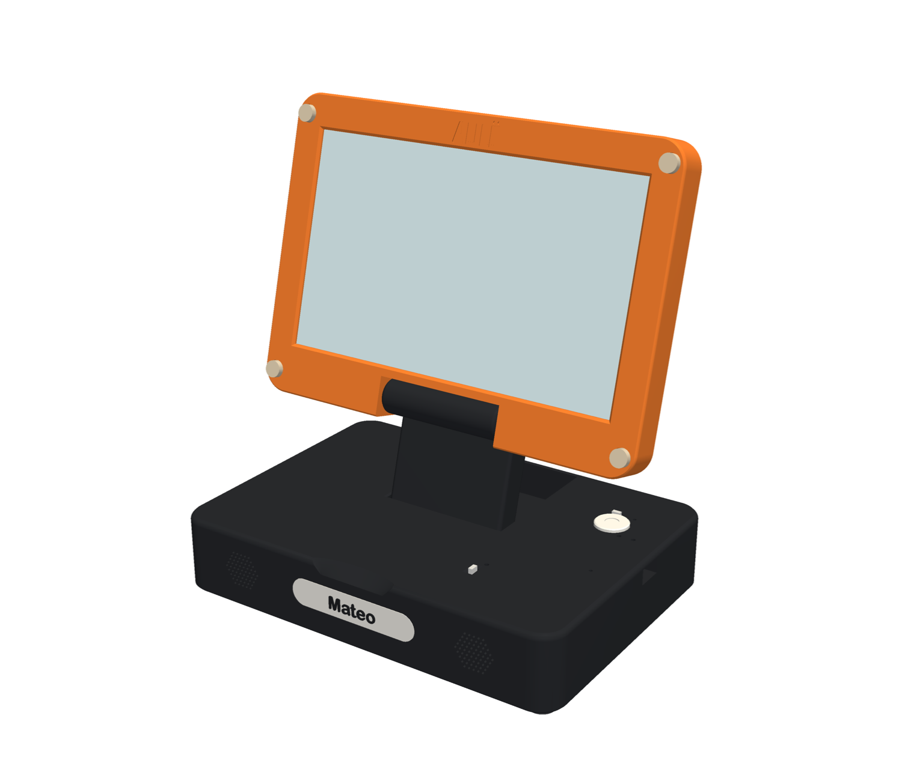
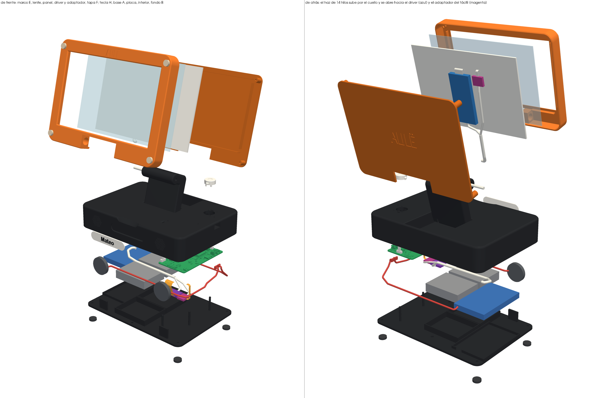

# Capricorn Hardware

<p>
  <a href="https://github.com/aule-org/capricorn-hw"></a>
  <a href="https://github.com/aule-org/capricorn-fw"></a>
  <a href="https://github.com/aule-org/capricorn-sw"></a>
  <a href="https://github.com/aule-org/capricorn-app"></a>
  <a href="LICENSE"></a>
</p>

(English | [Español](README.es.md))

<p align="center">
  
</p>

**Capricorn is the open-source AI tutor.** A calm, dedicated device for children: an e-ink page, a voice that listens, and a tutor that knows what the child already understands and what comes next. No feed, no ads, no glowing screen.

Every child deserves a patient tutor. Today, AI tutors are closed apps running on devices built for something else. We think a tutor for children should be the opposite: something families and schools can inspect, repair and improve. So we build Capricorn in the open: hardware, firmware and app.

This repository holds the hardware: the board, its fabrication files, the desk dock and the bill of materials.

> **Status: prototype v0.2.2.** The first five assembled boards are in production (November 2026) and have not been brought up yet. Everything here passes its design checks, but treat it as a reference until we publish bench results. Watch the repository to know when.

## Quick links

- [Hardware overview](hardware/README.md)
- [Bill of materials and costs](bom/README.md)
- [KiCad project](hardware/pcb/)
- [Fabrication files for JLCPCB](hardware/fab/)
- [Ordering guide: checking the placement preview](hardware/ordering/README.md)
- [Desk dock: STL, STEP and source](hardware/enclosure/README.md)
- [Firmware pin map](software/README.md)
- [Firmware](https://github.com/aule-org/capricorn-fw) · [Server](https://github.com/aule-org/capricorn-sw) · [Family app](https://github.com/aule-org/capricorn-app)

## The device

| | Prototype v0.2.2 |
|---|---|
| Processor | ESP32-S3-WROOM-1 (16 MB flash, 8 MB PSRAM), Wi-Fi and Bluetooth LE |
| Display | 7.5" e-ink (Good Display GDEY075T7-T01), 800 × 480, 4 grays, GT911 capacitive touch |
| Audio in | Two MEMS microphones into an ES7210 ADC, with echo-cancellation reference |
| Audio out | ES8311 codec and PAM8302A amplifier, two 28 mm speakers |
| Controls | A talk button, a microphone mute switch and a power switch. Touch replaces navigation buttons |
| Privacy | **Hardware microphone mute:** the switch cuts the microphones' supply and their "mic on" LED; the firmware cannot turn them back on |
| Sensors | LIS2DH12 accelerometer, to wake when picked up |
| Power | USB-C; LiPo battery with BQ24075 power-path charger, TPS63000 buck-boost and a battery thermal cut-off |
| Board | 92 × 48 mm, 4 layers, 147 parts, all orderable from LCSC |
| Enclosure | Folding desk dock, 194 × 138.5 mm, seven parts printed in PETG (about 13.5 h, 387 g) |

## Inside

<p align="center">
  
</p>

## Repository layout

```text
bom/        Bill of materials, off-board parts and cost of our first order
hardware/
  pcb/        KiCad 10 project
  fab/        Gerbers, drill files, BOM.csv and CPL.csv as sent to JLCPCB
  board/      STEP model of the assembled board
  enclosure/  Desk dock: parametric source (build123d), STEP, STL, renders
  ordering/   Part-by-part guide to JLCPCB's placement preview
software/   Pin map for the firmware
```

## How the pieces fit

```
capricorn-hw   the device: board, e-ink, audio, enclosure          (this repository)
capricorn-fw   firmware: xiaozhi-esp32 + a LiveKit (WebRTC) transport
capricorn-sw   central server: voice tutor, devices, family API
capricorn-app  the family app: set up the device, see progress, privacy controls
```

## Principles

- **Open by default.** Hardware, firmware and app are public. If you can buy it, you can build it.
- **Built on standards, not islands.** Firmware based on [xiaozhi-esp32](https://github.com/78/xiaozhi-esp32), voice over [LiveKit](https://github.com/livekit/client-sdk-esp32), common parts you can source anywhere.
- **Children first.** A hardware microphone mute. Parental consent. Children's data is not used to train models.
- **Repairable.** Standard connectors, a printable enclosure, and a parts list with real part numbers.

## Acknowledgments

- The e-ink high-voltage booster follows Waveshare's [e-Paper Driver HAT](https://www.waveshare.com/wiki/E-Paper_Driver_HAT) reference circuit and Good Display's panel documentation.
- The audio front end follows Espressif's ESP32-S3 voice designs (ES7210 + ES8311 with an echo-cancellation reference).
- The board was designed with [KiCad](https://www.kicad.org/) and [HeyPCB](https://heypcb.ai); the enclosure with [build123d](https://github.com/gumyr/build123d).
- Our repository layout is inspired by [Mu Robotics](https://github.com/murobotics-ai/handumi-hw).

## Contributing

Build reports, measurements and sourcing improvements are the most useful contributions right now. See [CONTRIBUTING.md](CONTRIBUTING.md).

## License

Apache License 2.0. See [LICENSE](LICENSE).

---

Made in Lima, Peru by [Aule](https://meetaule.com) · admin@meetaule.com
