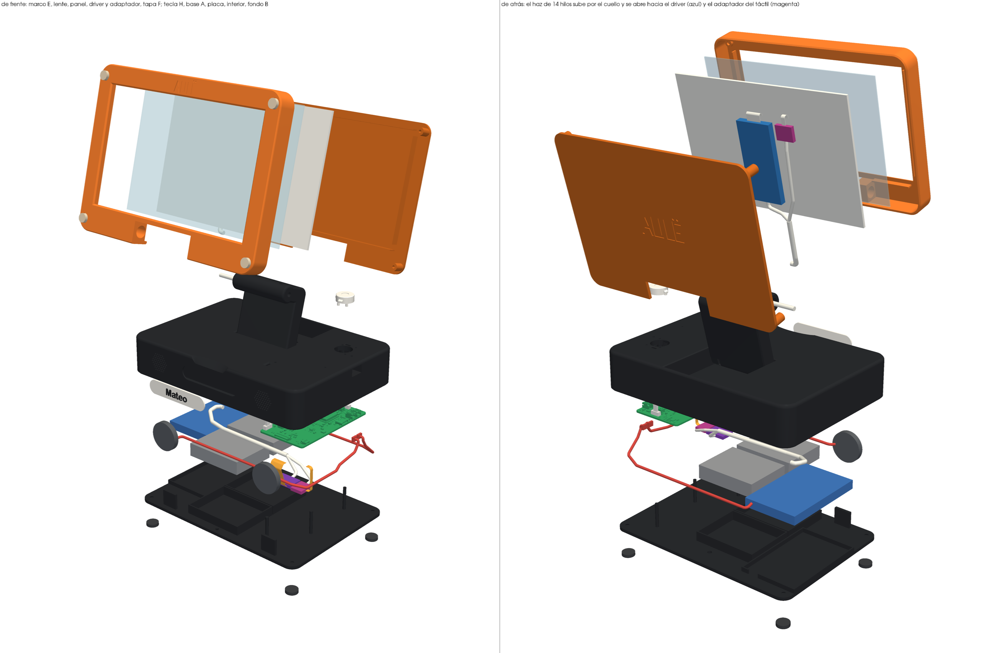
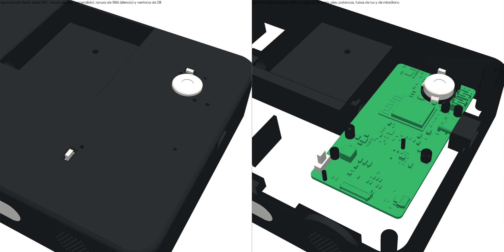
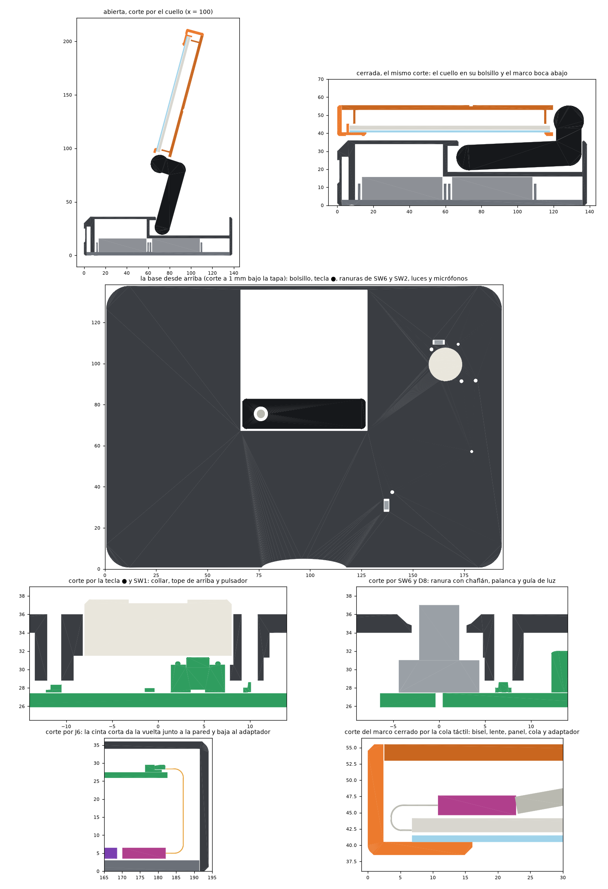
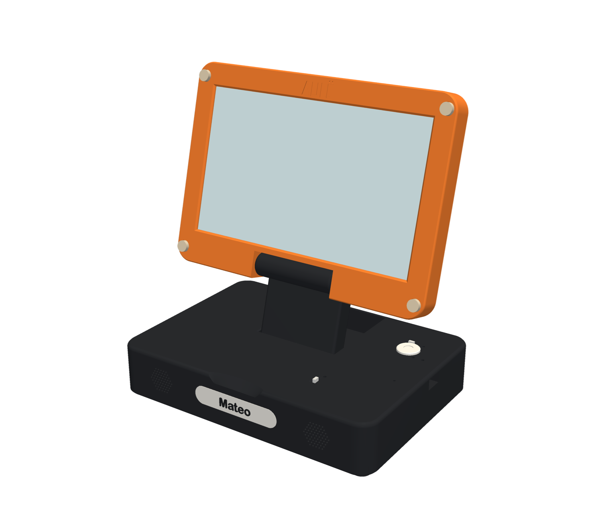

# Capricorn: base de escritorio plegable (capri-dock v2)

Es la segunda versión de la base de escritorio de Capricorn, adaptada a la placa táctil, hoy la **capri-slate v0.2.2 táctil** (misma geometría que la v0.2.1: solo cambian el valor de L2 y el texto de la serigrafía), y al panel **GDEY075T7-T01** (7.5", 800 × 480, táctil capacitivo GT911), y preparada para imprimir en PETG en la Elegoo Centauri Carbon.
La forma es la misma (cuello en L, marco del mismo contorno que la base, bisagra escondida), **con el bisel más fino**: base y marco miden 194 × 138.5 mm (antes 200 × 140), 36 mm de alto. Lo que la v1 explica y no cambió (plegado, herrajes de las bisagras, a prueba de niños) sigue en su README.

**Estado (2026-11-12):** `dock.py` pasa sus 635 controles contra `../board/capri-slate-v0.2.2-tactil.step`, que es su placa por omisión (617 con `--sin-lente`, 635 con `--colas-derecha`). `printcheck.py` pasa en las tres. Las 7 piezas y las 2 alternativas sin lente están laminadas.
**STEP de la v0.2.2:** [`../board/capri-slate-v0.2.2-tactil.step`](../board/capri-slate-v0.2.2-tactil.step) es la placa armada con los modelos 3D de todas las piezas: 129 sólidos. Contra él pasan los 635 controles.
**No está validada con el panel real:** las posiciones de las colas, los adaptadores y el driver son supuestos marcados MEDIR.

## Qué se puede imprimir ya y qué espera

| Pieza | ¿Ya? | De qué depende |
|---|---|---|
| `H-tecla-hablar`, `N-placa-nombre` | **Sí** | Nada del panel. H sirve para probar el clic de SW1 con la placa en la mano (7 minutos) |
| `C-cuello` | **Sí** | Solo del niple M10 × 1 (rosca en Ø9, paso interior de 6.5 mm o más) y del hilo AWG 30 |
| `B-fondo` | **Sí** | De la batería 805080 y de las platinas, que ahora se cortan de **57 mm** |
| `A-base` | **Sí, con un riesgo** | No depende del panel. Sí del interruptor SS12D00G6 real (palanca y alto, hoy una caja en el STEP) y de los parlantes de 28 mm. Es la cama larga (5 h 26 min): conviene medir el interruptor antes |
| `E-marco`, `F-tapa-marco` | **No: esperan al panel** | De dónde salen las dos colas, del driver, del adaptador del táctil y de si va con lente. Imprimirlas antes es apostar a los supuestos de la tabla de abajo |

## Bisel: antes y después

| | v1 y primera v2 | Ahora | Cambio |
|---|---|---|---|
| Contorno de marco y base | 200 × 140 mm | **194 × 138.5 mm** | −6 y −1.5 |
| Del borde del marco al panel, a los lados | 14.9 mm | **11.9 mm** | −3.0 por lado |
| Arriba | 8.3 mm | **6.8 mm** | −1.5 |
| Abajo (adentro va la bisagra H2) | 20.5 mm | 20.5 mm | igual |
| Bisel a la vista, hasta el área activa: lados / arriba / abajo | 17.9 / 17.6 / 23.5 mm | **14.9 / 16.1 / 23.5 mm** | |

Qué hubo que mover para que pasaran los controles (el intento anterior, solo angostar, rompía 10):
- **Marco:** las 4 torres de tornillo y sus topes van 3.5 mm más hacia las esquinas, fuera del panel.
- **Lastre:** platinas de 57 mm en vez de 60 (506 g en vez de 533), pegadas a la bahía de la batería: quedan a 16 mm de la antena.
- **Batería:** contra la pared izquierda y 2 mm más adelante, para no pisar la torre de la esquina.
- **Buje del pasador de H1:** 3.5 mm en vez de 5, con la cabeza del M4 embutida: queda a 0.6 mm del borde de la placa, con 2.8 mm de apoyo (antes 7.5).
- **Cables:** recorridos atados a la pared derecha y a la punta del niple, no a coordenadas fijas.
- **Estabilidad:** pesa ~1176 g; empujar el centro de la pantalla la vuelca con 4.6 N (antes 4.9; el mínimo es 3).

**Por qué no más:** a los lados, la torre de Ø7 ya está entre la guía del panel y la pared del marco, y en la base el lastre ya se acortó para guardar los 15 mm de la antena. Arriba, el doblez de las colas usa 3.3 de los 4.4 mm que quedan. Abajo manda la bisagra.









## Qué cambió contra la v1

| Tema | v1 | v2 |
|---|---|---|
| **Botones de navegación** | Peine G con 3 palancas sobre SW3, SW4 y SW5 | **No están en la placa: salió todo.** Sin pieza G, sin sus 3 agujeros, sin postes de remache, sin empujadores ni láminas. La tapa queda cerrada ahí |
| **Tecla ● (H)** | Sobre SW4, empujada por el peine | **Sobre SW1**, el único pulsador que queda. Es un émbolo macizo de Ø16 con guía, tope de arriba y tope de abajo. La tapa chica de SW1 (pieza D) ya no existe |
| **Ranuras de SW6 y SW2** | Centradas en el origen de la huella, que es el **pad 1**: quedaban a 2.5 mm del centro de la palanca | Centradas en el cuerpo real del interruptor, leído del STEP. La de SW6 lleva un chaflán de 45° para la yema del dedo |
| **Panel** | 1.18 mm, una cola al centro | 2.13 mm, dos colas hacia un extremo del borde. Las guías de E son 0.95 mm más hondas y las costillas de F más cortas; el marco mide lo mismo |
| **Lente** | Fijo | Un parámetro: `--sin-lente` (por omisión, con lente) |
| **Driver del panel** | Acostado y centrado | **De pie**, bajo la cola de 24 pines, con el adaptador del táctil al lado |
| **Cables por las bisagras** | 8 hilos, canal de Ø6 | **14 hilos** (8 del panel + 6 del táctil), canal de Ø7 |
| **Táctil en la base** | No había | Adaptador de 6 pines en el piso y cinta corta que sale de J6 y da la vuelta junto a la pared derecha |
| **Impresión** | "Sin soportes", pero no salía así (ver abajo) | Controlada capa por capa. Solo A lleva soporte, en un lugar |
| **Bisel** | Marco y base de 200 × 140 | 194 × 138.5: 3 mm menos por lado y 1.5 arriba (ver arriba) |
| **STL** | En su lugar | **En la orientación de impresión** (la cama en z = 0). Los STEP siguen en su lugar |

`--vista` no se portó: lo reemplaza `render.py`. El modelo para el visor 3D sí: ver [Visor 3D](#visor-3d).

### La tecla ● sobre SW1

- **No puede ir centrada en SW1:** a 5.7 mm está el LED D1 y a 6.3 mm la ranura de SW2. Va corrida 4.3 mm (hacia el frente y hacia el USB) y aprieta el pulsador con su cara de abajo. Quedan 0.78 mm de tapa hasta el agujero de D1 y 1.4 mm hasta la ranura de SW2.
- **Guía:** el agujero de la tapa más un collar por debajo, 4.5 mm en total, con 0.2 mm de holgura por lado.
- **Tope de arriba:** dos orejas a 45° que asientan en la tapa. También impiden que gire y que la arranquen. Entra por abajo, antes que la placa.
- **Tope de abajo:** dos pies de Ø2.2 que apoyan en placa libre 0.5 mm después de tocar SW1 (`TALK_STOP`). Con SW1 forman un trípode: la tecla no se hunde ni se ladea más. **No descargan el pulsador:** el TL3305 hace fondo a los 0.25 mm; un tope más corto arriesga que no llegue a cerrar.
- **Queda detrás de la pantalla abierta.** SW1 está al fondo a la derecha de la base (a 103 mm del frente); el marco abierto arranca a 60 mm. Se alcanza por el costado. Traerla al frente pide mover el pulsador en la placa.

### Lo que la v1 no podía imprimir sin soportes

`printcheck.py` lo encontró en las piezas de la v1 que la v2 heredaba; todo quedó corregido salvo el primero:

| Dónde | Problema | Qué se hizo |
|---|---|---|
| A, piso del bolsillo del cuello | Techo de 62 × 75 mm a 17.5 mm de la cama | **Lleva soporte**, solo ahí, desde la cama. Sale en un bloque |
| A, hueco del pulgar | Elipsoide: su techo quedaba en voladizo | Paredes a 45° |
| A, aros de los parlantes | El aro cerraba en el aire | Bloque con media caña y dos arcos hasta 45° |
| A, buje del pasador de H1 | Nacía en el aire | Unido a la tapa |
| A, rebaje de la placa del nombre | Canto de 1.2 mm en voladizo | Canto a 45°; la placa N lleva el mismo bisel |
| A y E, redondeo que va sobre la cama | La mitad de abajo pasa de 45° | Faceta de 45° tangente al redondeo (0.9 mm en A, 0.45 mm en E) |
| C, ranuras de las tuercas M4 | El paso del pasador partía su techo | Piel de 0.2 mm que el tornillo perfora, y un rebaje en la boca de la de H1 |
| B y E, cajuelas de patas y topes | Techo en anillo alrededor del avellanado | Piel de 0.2 mm que el tornillo perfora |
| H, ala de la tecla | Anillo en voladizo | Orejas a 45° |

## Piezas

| Archivo | Qué es | Cómo se imprime | Tiempo | PETG |
|---|---|---|---|---|
| `A-base.stl` | Tapa y paredes de la base: bolsillo del cuello, agujero y collar de la tecla, ranuras de SW6 y SW2, guías de luz, tubos de micrófono, apoyos de la placa, túnel USB, parlantes | Tapa sobre la cama. **Con soporte solo en el bolsillo** | 5 h 26 min | 158.7 g |
| `B-fondo.stl` | Fondo: bolsillos del lastre, bahía de la batería, pernos de la placa | Plano, la cara de afuera sobre la cama | 2 h 28 min | 70.0 g |
| `C-cuello.stl` | Cuello en L, con el canal de Ø7 | De costado, la cara izquierda sobre la cama. **5 perímetros** | 1 h 34 min | 44.5 g |
| `E-marco.stl` | Marco: bisel, guías del panel, bloques de H2 | Cara del frente sobre la cama | 1 h 46 min | 50.0 g |
| `F-tapa-marco.stl` | Tapa del marco, con las costillas del panel | Cara de atrás sobre la cama | 2 h 04 min | 61.8 g |
| `H-tecla-hablar.stl` | Tecla ● | Cara de arriba sobre la cama | 7 min | 1.0 g |
| `N-placa-nombre.stl` | Placa del nombre (`--nombre=…`) | Boca arriba; pausa a 1.2 mm para pasar de blanco a negro | 4 min | 1.3 g |
| | **Total (con lente)** | | **13 h 29 min** | **387 g** |
| `sin-lente/E-marco.stl` | Alternativa a E para armar sin lente | Igual que E | 1 h 45 min | 49.5 g |
| `sin-lente/F-tapa-marco.stl` | Alternativa a F para armar sin lente | Igual que F | 2 h 05 min | 62.5 g |

Colores: A, B y C en negro (273 g); E y F en el color del marco (112 g); H y N en blanco.
Sin lente se cambian E y F por las de `sin-lente/` (las demás piezas no cambian): el total queda igual, 13 h 29 min y 387 g.

**Laminado:** ElegooSlicer, Centauri Carbon, boquilla 0.4, PEI texturada. PETG a 250 °C, cama a 70 °C, ventilador de pieza con tope en 25 %, capa de 0.2 mm, 3 perímetros, 20 % de giroide. Los gcode no se versionan: `laminar.py` los genera con estos ajustes.

### Reglas de impresión y cómo se cumplen

| Regla | Resultado |
|---|---|
| Cama de 256 mm | La pieza más grande mide 194 × 138.5 mm |
| Paredes de 1.2 mm o más | Base 2.4 / 2.0 / 3.0; marco 2.4 / 2.0 / 2.5; costillas, guías, collar y tubos 1.2. **Excepciones:** la guía de luz de D1 baja a 0.45 mm en sus 2.5 mm de abajo, donde pasa entre SW1 y SW2; la rejilla de los parlantes tiene nervios de ~1 mm; bajo el chaflán de SW6 quedan 0.8 mm de tapa |
| Sin voladizos de más de 45° | `printcheck.py`: ningún voladizo ni isla. Quedan escalones de menos de una línea (0.5 mm) en hasta 5 capas seguidas: el techo de los agujeros redondos horizontales (paso de los niples Ø10.3, canal Ø7) |
| Puentes de 20 mm o menos | El más largo mide 13.0 mm (techo del túnel USB) |
| Láminas flexibles para PETG | **No queda ninguna.** La única de la v1 era la del peine de teclas |
| Holgura de 0.15 a 0.2 mm por lado | 0.15 en B dentro de A, F dentro de E y la placa N; 0.2 en la tecla; 0.15 en los pasos de los niples |

## Táctil y cableado

`dock.py` modela cada cable como un tubo por su recorrido y controla que no pise ninguna pieza.

| Cable | De | A | Largo del modelo |
|---|---|---|---|
| Cola de 24 pines | borde de arriba del panel, por atrás | driver, doblada sobre el borde | 11 mm |
| Cola táctil de 6 pines | borde de arriba del panel, por el frente | adaptador del marco, doblada sobre el borde | 13 mm |
| 8 hilos del panel | driver (por abajo) | unión, en el marco | 27 mm |
| 6 hilos del táctil | adaptador del marco | unión, en el marco | 67 mm |
| Haz de 14, marco | unión | niple de H2 | 45 mm |
| Haz de 14, cuello | niple de H2 | niple de H1, por el canal | 130 mm |
| Haz de 14, base | niple de H1 | unión, sobre el lastre | 124 mm |
| 8 hilos del panel | unión | adaptador de J5 | 25 mm |
| 6 hilos del táctil | unión | adaptador de J6 | 41 mm |
| Cinta corta de J5 | J5 | su adaptador, por el borde de adelante de la placa | 30 mm |
| Cinta corta de J6 | J6 | su adaptador, dando la vuelta junto a la pared derecha | 31 mm |

- **Los 8 hilos del panel miden 351 mm y los 6 del táctil 407 mm.** Cortar los 14 de 450 mm.
- **Hilo supuesto:** silicona AWG 30, Ø0.8 mm con aislante. Los 14 hacen un haz de Ø3.5: ocupan el 18 % del canal del cuello (Ø7) y el 21 % del niple (Ø6.5 supuesto). **Con AWG 28 (Ø1.2) no pasan.**
- **Pines del táctil:** 1 GND, 2 3V3, 3 RESET, 4 INT, 5 SDA, 6 SCL, uno a uno entre los dos adaptadores.
- **J6 abre hacia la pared derecha.** La cinta tiene 5 mm para dar la vuelta con radio 2.5 y baja al adaptador, en el piso bajo el borde de la placa. El cable de los parlantes se corrió contra la pared para dejarle lugar.
- **Lente y táctil:** con lente, entre el policarbonato y el panel queda la junta de 0.5 mm, o sea aire sobre el área activa. Eso es lo peor para un táctil capacitivo. Hay que probarlo antes de decidir; `--sin-lente` es la salida.

## Ferretería

- **Bisagras:**
  - 2 niples de lámpara M10 × 1 de ~30 mm, con tuerca moleteada fina de Ø14 y arandela de presión; paso interior de 6.5 mm o más;
  - 1 tornillo M4 × 25 de nylon con tuerca de nylon (H1), de cabeza cilíndrica o alomada de Ø8 o menos y 3 mm de alto (va embutida en su buje), y 1 de acero con tuerca y arandela de presión (H2);
  - 4 arandelas de PTFE de 1 mm (M10 y M4).
- **Base:** 5 tornillos M3 × 10 autorroscantes para plástico, de cabeza avellanada, desde abajo.
- **Marco:** 4 tornillos M3 × 12 autorroscantes avellanados, desde el frente, bajo los topes.
- **Placa:** 1 tornillo M2 × 6 **de nylon** en H1, desde abajo.
- **Panel:**
  - Good Display GDEY075T7-T01 (7.5", con táctil GT911);
  - driver Waveshare 13512, sin el conector de 40 pines, en el marco;
  - adaptador FPC de 24 pines a 2.54 mm para J5;
  - 2 adaptadores FPC de 6 pines, paso 0.5 mm, a pads para soldar, y 1 cinta FFC de 6 pines, paso 0.5 mm, de 50 mm, para J6.
- **Cables:** 14 hilos de silicona AWG 30 de 450 mm (8 del panel y 6 del táctil); con AWG 28 no pasan por las bisagras. Silicona neutra para el alivio de tensión.
- **Lastre:** 4 trozos de platina de acero de 1¾ × ¼ pulgada (44.5 × 6.35 mm) de **57 mm**, apilados de a dos y pegados con silicona.
- **Batería:** LiPo 805080.
- **Audio:** 2 parlantes de 28 mm, 8 Ω, 2 W, en paralelo a J3 (4 Ω, dentro de lo que acepta el PAM8302A).
- **Goma:**
  - 4 topes transparentes de Ø8 × 3.5 mm para el bisel, que entran 1 mm en su cajuela (**MEDIR** que haya esa medida; si no, ajustar `GAP_C` y `BUMP_REC`);
  - 4 patas adhesivas de Ø12 × 3 mm, hundidas 1 mm sobre los tornillos de las esquinas.
- **Lente (opcional):** policarbonato antirreflejo de 1 mm, 170.2 × 111.2 mm (corte láser), y junta de espuma de 0.5 mm alrededor del área activa. Sin lente, usar las piezas de `sin-lente/`.
- **Espuma EVA de 1.5 mm:** una tira sobre el borde de atrás del panel y un rectángulo bajo la batería.
- **Juntas:**
  - 2 juntas de espuma de 0.5 mm, en anillo, para los parlantes;
  - 2 anillos de Ø2.8 / Ø1.6 × 1.3 mm para sellar los micrófonos.

## Armado

1. **Cables.**
   1. Soldar 8 hilos al adaptador de J5 y 6 al adaptador de J6.
   2. Juntarlos y pasarlos por el niple de H1, el canal del cuello (el agujero del codo ayuda) y el niple de H2.
2. **Placa en A.**
   1. Poner los anillos de los micrófonos.
   2. Meter la tecla ● (H) desde adentro, con las orejas en sus ranuras.
   3. Apoyar la placa con los componentes hacia la tapa: las palancas de SW6 y SW2 entran en sus ranuras.
   4. Atornillar el M2 de nylon.
   5. Enchufar la cinta de 24 pines en J5 y la de 6 en J6, y cada una en su adaptador.
3. **H1, parlantes, fondo B y cierre de la base:** como en la v1.
4. **Marco.**
   1. Poner en E el lente y la junta (o solo la junta), y el panel boca abajo **con las colas hacia arriba**.
   2. Pegar el driver detrás del panel, de pie bajo la cola de 24 pines, y el adaptador del táctil bajo la suya. Enchufar las dos colas.
   3. Montar H2 como en la v1.
   4. Soldar los 8 hilos al driver y los 6 al adaptador. El haz sube por la izquierda, por la muesca de la costilla de abajo de F.
   5. Silicona en las puntas de los niples. Cerrar con F.
5. **Goma y acabado:** como en la v1.

## Medir antes de imprimir

Todos están al inicio de `dock.py`.

| Parámetro | Valor | Qué medir |
|---|---|---|
| `TAIL_END` | −1 (izquierda, de frente) | De qué extremo del borde salen las colas. El otro: `--colas-derecha` (pasa los 635 controles) |
| `TAIL_DISP`, `TAIL_DISP_W` | 47 / 12.5 mm | Centro y ancho de la cola de 24 pines |
| `TAIL_TOUCH`, `TAIL_TOUCH_W` | **20** / 3.5 mm | Centro y ancho de la cola táctil. **El 20 es un supuesto:** el dibujo solo dice "más cerca del mismo extremo". Cada cola tiene 4 mm de aire por lado |
| `PT` | 2.13 mm | Espesor del panel con táctil |
| `DRIVER`, `DRV_FPC_OFF` | 30.2 × 65 × 5 mm, 0 | El driver y dónde tiene su conector FPC. **Se supone en un lado corto**; si está en uno largo, el driver va acostado y hay que mover el adaptador |
| `TOUCH_AD`, `J6_ADAPTER` | 15 × 12 × 3 y 12 × 15 × 3 mm | Los adaptadores de 6 pines que se compren |
| `WIRE_D`, `NIP_ID` | 0.8 / 6.5 mm | El hilo con aislante y el paso interior del niple |
| `LENTE`, `LENS_T`, `GASKET`, `FOAM` | con lente, 1 / 0.5 / 1.5 mm | El táctil a través del lente. Las espumas que se consigan |
| `SLIDE_BODY`, `SLIDE_TOP`, `SLIDE_LEVER`, `SLIDE_TRAVEL` | 3.5 / 9.5 / 2 / 2 mm | El SS12D00G6 real: alto, palanca y recorrido. En el STEP es una caja maciza |
| `TALK_STOP` | 0.5 mm | Que SW1 haga clic antes de que los pies toquen la placa |
| Puerto de MK1 y MK2 | origen de la huella | El cuerpo del micrófono en el STEP está 0.26 mm corrido del origen; el tubo tolera 0.5 |
| Cinta de J6 | 50 mm, lado de contactos sin confirmar | J6 es de contacto inferior; la cinta llega al adaptador dada vuelta |

Los de la v1 que siguen valiendo: `AA_TOP`, `NIP_D`, `NIP_TAP`, `NUT_R`, `GAP_C`, `BUMP_REC`, `SPK_D`, `SPK_T`, `BATT`, `LASTRE`, `MASS`.

## Controles

`dock.py` no exporta si falla alguno de sus **635 controles** (617 con `--sin-lente`):
- **placa real (STEP):** SW1, el cuerpo de SW6 y de SW2, los 4 LEDs, los 2 micrófonos y J6 están donde la carcasa los espera; en el lugar de SW3, SW4 y SW5 no queda ningún pulsador;
- **tecla ●:** SW1 queda bajo la tecla; en reposo está a 0.18 mm; hace el recorrido sin rozar; tope de arriba y tope de abajo; guía; tapa suficiente hasta D1, D2, MK2 y SW2;
- **SW6 y SW2:** la palanca recorre sus 2 mm con 1 mm de aire por punta y 0.2 por lado, asoma 1 mm y queda bajo el marco cerrado; la ventana de D8 queda fuera del chaflán;
- **panel:** de 2.13 mm, sujeto con la espuma apretada 15 %; el bisel lo pisa 3 mm o más por borde, con o sin lente;
- **táctil:** las colas no se pisan; el adaptador cabe junto al driver; 14 hilos por el canal y por el niple; la cinta de J6 tiene lugar para la vuelta;
- **cables:** ninguno pisa una pieza, la placa, la batería, el lastre, los parlantes, los adaptadores, el panel, el lente ni el driver;
- **abierta, cerrada y a 20, 40, 60 y 80 % del giro:** interferencia 0 entre todas las piezas y contra el STEP de la placa;
- **impresión:** cada pieza cabe en la cama en su orientación; paredes y holguras;
- los de la v1 que siguen: antena, parlantes, placa del nombre, logo, estabilidad y forzado de las bisagras.

## Visor 3D

`dock.py --glb` escribe `capri-dock-v2.glb`: la base abierta, en metros, con una pieza por nodo (273 nodos; la placa va en `placa-0` … `placa-N`) y la misma línea `visor {…}` de cinemática que la v1. No está publicado en ningún lado.
- **Nombres de nodo:** `A`, `B`, `C`, `E`, `F`, `H`, `N`, `letras`, `logo`, `panel`, `lente`, `driver`, `adaptador-tactil`, `adaptador-J5`, `adaptador-J6`, `cintas`, `haz-base`, `haz-cuello`, `cables-marco`, `otros-cables`, `palancas`, `bateria`, `lastre`, `parlantes`, `patas`, `topes`.
- **Contra el GLB de la v1:** no existen `D` ni `G`; `nombre` pasó a `N`; los cables y parlantes se agrupan distinto. Un visor que busque los nombres de la v1 hay que ajustarlo.
- Se comprobó que carga y se dibuja (trimesh y pyvista); no se probó en la página del visor.

`printcheck.py` es un control aparte, sobre los STL: compara cada capa de 0.2 mm con la de abajo y no acepta voladizos, islas, puentes de más de 20 mm ni pendientes de más de 45° fuera de la zona de soporte declarada en `impresion.json`.

```sh
# desde hardware/enclosure/
uv run --python 3.12 --with build123d python -I dock.py                       # piezas y controles (~50 s)
uv run --python 3.12 --with build123d python -I dock.py SALIDA --sin-lente    # sin lente (crear SALIDA antes)
uv run --python 3.12 --with build123d python -I dock.py SALIDA --colas-derecha
uv run --python 3.12 --with build123d python -I dock.py SALIDA --board=../board/OTRA.step
uv run --python 3.12 --with build123d --with matplotlib python -I dock.py --cortes --escena=/tmp/escena --glb   # + capri-dock-v2.glb
uv run --python 3.12 --with pyvista python -I render.py /tmp/escena           # vista.png, explosionada.png, controles.png
uv run --python 3.12 --with trimesh --with shapely --with numpy --with scipy --with networkx --with rtree python -I printcheck.py
cp SALIDA/E-marco.st* SALIDA/F-tapa-marco.st* sin-lente/                      # después de correr --sin-lente: son las dos piezas que cambian
python3 -I laminar.py                                                         # gcode en ~/Documents/Capricorn - impresión/ (borra los anteriores)
```
