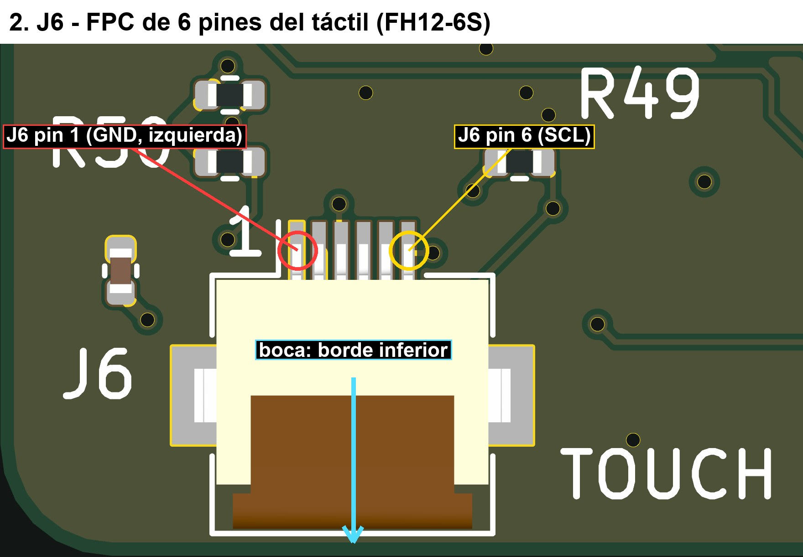
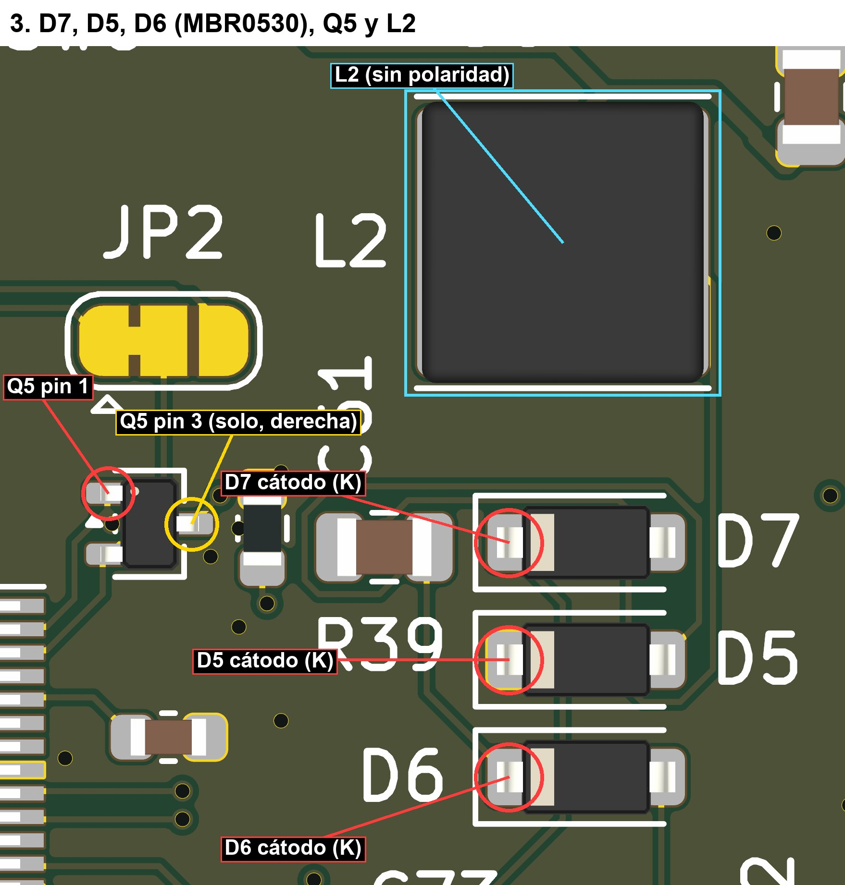
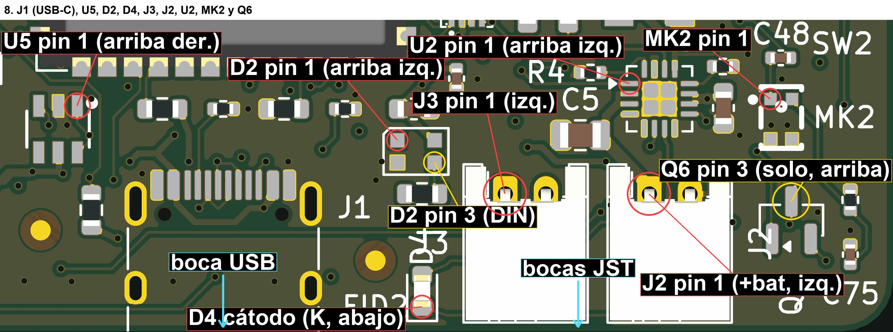
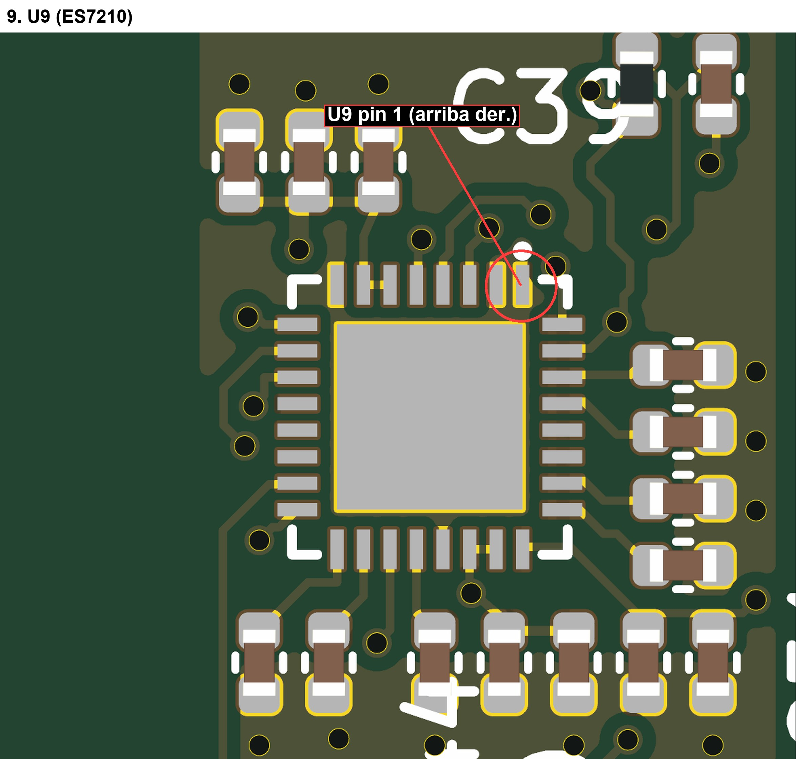
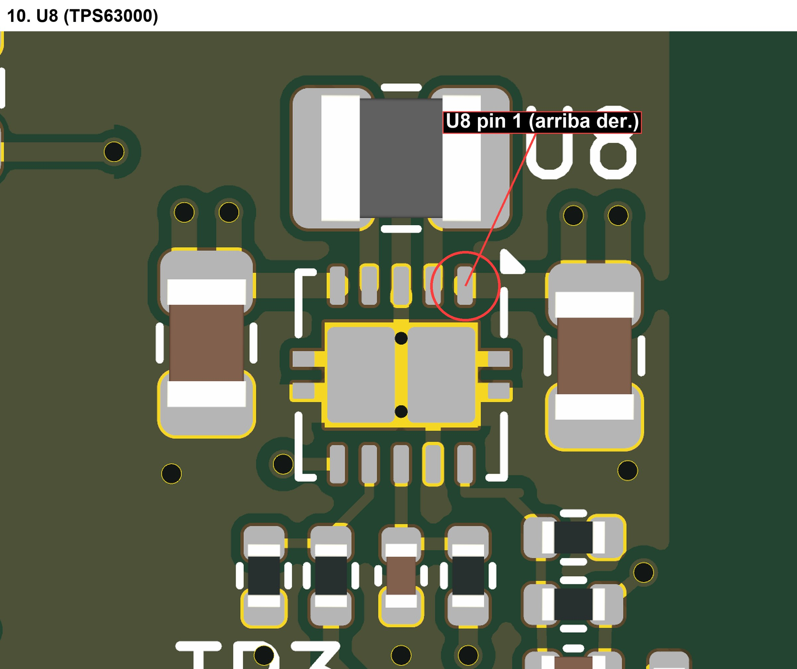
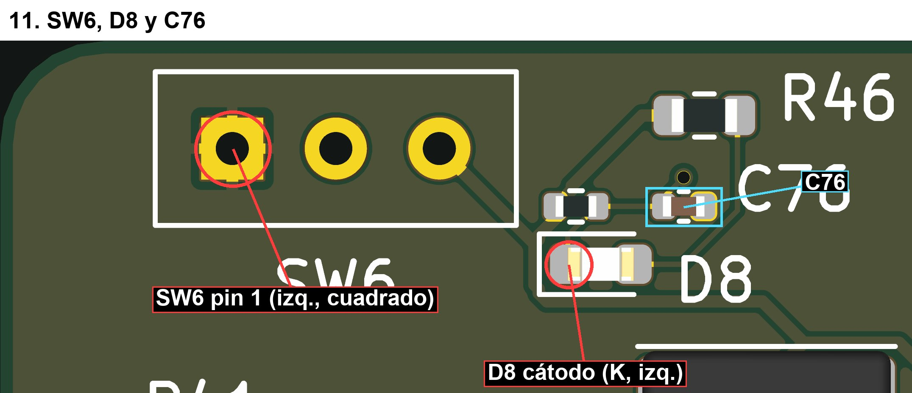

**Para qué sirve.** Antes de pagar, JLCPCB muestra un dibujo de la placa con cada pieza colocada («vista previa de colocación»). Es el único control que no se puede hacer desde los archivos. Esta guía dice, pieza por pieza, cómo se ve **bien**. Si algo no coincide, no pagar: se gira la pieza en el editor de JLCPCB o se deja el pedido en «Review Before Payment» y se les escribe.

**Cómo leer las imágenes.** Son de la placa vista desde arriba, con la antena (zona verde sin cobre) arriba y el USB abajo. Las marcas salen del archivo de la placa ([`../pcb/esp32-audio-module.kicad_pcb`](../pcb/esp32-audio-module.kicad_pcb)):

- **Círculo rojo:** pin 1 de la pieza o, en diodos y LED, el **cátodo (K)**. La marca de pin 1 o de polaridad que dibuja JLCPCB tiene que caer ahí.
- **Círculo amarillo:** otro pin de referencia (el pin «solo» de un transistor, el último pin de un conector).
- **Flecha o recuadro celeste:** hacia dónde mira la boca de un conector, o una pieza sin polaridad.

Las imágenes son un render de KiCad: los colores y la forma de las piezas no serán iguales a los de JLCPCB; lo que tiene que coincidir es **la posición, el giro y la marca de pin 1**. A SW2, SW6, J1 y los micrófonos el render no les dibuja el cuerpo; se ven solo sus pads.

Las columnas X, Y y giro son las de [`../fab/CPL.csv`](../fab/CPL.csv) (mm desde la esquina inferior izquierda, Y hacia arriba), para ubicar la fila en la tabla de JLCPCB. Si JLCPCB muestra otro giro en la tabla pero el dibujo coincide con esta guía, vale el dibujo.

# Los tres errores caros

| # | Qué | Por qué es caro | Cómo reconocerlo |
|---|---|---|---|
| 1 | **J5 o J6 girados 180°** | El panel o el táctil no se pueden conectar; son conectores de paso 0.5 mm, difíciles de resoldar | Los contactos finos deben quedar **hacia el centro** de la placa y la boca **hacia el borde** (J5: borde izquierdo; J6: borde inferior). Si la boca mira hacia adentro, está al revés |
| 2 | **D5, D6 o D7 al revés** | No se generan los voltajes del panel de tinta y puede dañarse el elevador | La franja (cátodo) de los tres debe quedar **a la izquierda**, del lado de J5. Los tres iguales |
| 3 | **U10 o un QFN (U2, U4, U8, U9) girado** | El chip queda conectado a pines equivocados; puede calentar o no cargar la batería | El punto de pin 1 debe caer en el círculo rojo: U10 arriba a la izquierda; U2 arriba a la izquierda; U4 abajo a la izquierda; U8 y U9 arriba a la derecha |

# Zona por zona

## 1. J5, conector del panel (24 pines)

{width=45%}

| Pieza | CPL X | CPL Y | Giro | Correcto |
|---|---:|---:|---:|---|
| **J5** FH12-24S-0.5SH, contacto inferior | 5.205 | 24.000 | 90 | Los 24 contactos finos miran hacia el centro de la placa (derecha) y la boca hacia el **borde izquierdo**. Pin 1 es el de **arriba** (sin conexión); pin 2 es EPD_GDR; pin 24, el de abajo, es EPD_VCOM. Las dos pestañas de anclaje quedan arriba y abajo, del lado del borde |

## 2. J6, conector del táctil (6 pines)

{width=70%}

| Pieza | CPL X | CPL Y | Giro | Correcto |
|---|---:|---:|---:|---|
| **J6** FH12-6S-0.5SH, contacto inferior | 7.900 | 5.230 | 180 | Los 6 contactos finos miran hacia el centro de la placa (arriba) y la boca hacia el **borde inferior**. Pin 1 (GND) es el de la **izquierda**, junto al «1» de la serigrafía; pin 6 (TOUCH_SCL) a la derecha |

## 3. Diodos del panel, Q5 y L2

{width=70%}

| Pieza | CPL X | CPL Y | Giro | Correcto |
|---|---:|---:|---:|---|
| **D7** MBR0530 | 19.000 | 31.100 | 0 | Cátodo (franja) a la **izquierda** (red EPD_PREVGH); ánodo a la derecha (EPD_SW) |
| **D5** MBR0530 | 19.000 | 28.600 | 0 | Cátodo a la **izquierda** (GND); ánodo a la derecha (EPD_PUMP) |
| **D6** MBR0530 | 19.000 | 26.100 | 0 | Cátodo a la **izquierda** (EPD_PUMP); ánodo a la derecha (EPD_PREVGL) |
| **Q5** Si1308EDL, SOT-323 | 9.671 | 31.500 | 180 | Dos patas a la izquierda (pin 1 arriba, EPD_GDR; pin 2 abajo) y la pata sola (pin 3, EPD_SW) a la **derecha** |
| **L2** 10 µH, C79272 | 18.500 | 37.500 | 0 | Sin polaridad. Cuadrado de 6 × 6 mm centrado sobre sus dos pads (izquierda y derecha) |

## 4. U10, Q4, Q3 y MK1

{width=75%}

| Pieza | CPL X | CPL Y | Giro | Correcto |
|---|---:|---:|---:|---|
| **U10** MCP65R41, SOT-23-6 | 29.900 | 14.300 | 270 | Patas a izquierda y derecha, tres por lado. Pin 1 (CHG_HOT) **arriba a la izquierda**; pin 6 (VSYS) arriba a la derecha |
| **Q4** 2N7002, SOT-23 | 27.850 | 8.821 | 270 | Pata sola (pin 3, CHG_TEMP) **arriba**; dos patas abajo, pin 1 (CHG_HOT) abajo a la izquierda |
| **Q3** 2N7002, SOT-23 | 38.021 | 8.500 | 180 | Dos patas a la izquierda (pin 1 arriba) y la pata sola (pin 3, VBUS_SENSE) a la **derecha** |
| **MK1** micrófono ZTS6216 | 34.265 | 3.925 | 0 | Pin 1 (salida) **arriba a la izquierda**; los dos pads de abajo son GND |

## 5. U4, Q1 y C18

{width=55%}

| Pieza | CPL X | CPL Y | Giro | Correcto |
|---|---:|---:|---:|---|
| **U4** ES8311, QFN-20 | 42.000 | 27.050 | 0 | Pin 1 (I2C_SCL) en la fila de abajo, el de **más a la izquierda** (esquina inferior izquierda) |
| **Q1** SI2301CDS, SOT-23 | 46.500 | 12.942 | 90 | Dos patas arriba (pin 1 a la **derecha**, pin 2 a la izquierda) y la pata sola (pin 3, AUDIO_3V3) **abajo** |
| **C18** 1 µF 0402 | 41.500 | 31.000 | 90 | Sin polaridad; vertical, justo arriba de U4. Es uno de los tres 0402 con vía en el pad: mirar que quede centrado |

## 6. U1, módulo ESP32

{width=60%}

| Pieza | CPL X | CPL Y | Giro | Correcto |
|---|---:|---:|---:|---|
| **U1** ESP32-S3-WROOM-1-N16R8 | 58.999 | 22.225 | 0 | La antena (parte del módulo sin tapa metálica) hacia el **borde superior**, sobre la zona sin cobre. Pin 1 (GND) es el primero de la columna **izquierda, arriba**. La tapa metálica queda hacia el USB |

## 7. SW1, D1, SW2, U6 y U7

| Pieza | CPL X | CPL Y | Giro | Correcto |
|---|---:|---:|---:|---|
| **SW1** TL3305 (fila **UNVERIFIED** del CPL) | 80.000 | 19.500 | 90 | Las cuatro patas salen **hacia arriba y hacia abajo** y caen sobre los cuatro pads (dos arriba, dos abajo). Si las patas salen hacia los lados, está girado 90° y hay que girarlo. Es simétrico: 180° da lo mismo |
| **D1** LED rojo 0603 | 84.000 | 23.500 | 270 | Vertical. Cátodo **arriba** (U2_STAT) |
| **SW2** SS12D00G6, agujero pasante | 87.500 | 20.000 | 90 | Tres patas en línea vertical sobre sus tres agujeros, pegado al borde derecho; pin 1 (pad cuadrado, VSYS) **abajo**. El cuerpo es simétrico: solo importa que esté centrado en los tres agujeros |
| **U6** PAM8302, MSOP-8 | 71.555 | 24.000 | 0 | Patas arriba y abajo. Pin 1 (PA_EN) **abajo a la izquierda** |
| **U7** LIS2DH12, LGA-12 | 71.000 | 16.195 | 0 | Pin 1 (I2C_SCL) en la fila de abajo, **a la izquierda** |

## 8. Borde inferior derecho: J1, U5, D2, D4, J3, J2, U2, MK2 y Q6

| Pieza | CPL X | CPL Y | Giro | Correcto |
|---|---:|---:|---:|---|
| **J1** USB-C | 59.000 | 4.765 | 0 | Boca hacia el **borde inferior**; la fila de contactos finos hacia el centro de la placa |
| **U5** USBLC6-2, SOT-23-6 | 50.860 | 10.000 | 180 | Patas arriba y abajo. Pin 1 **arriba a la derecha** |
| **D2** WS2812B-2020 | 68.505 | 8.900 | 0 | Pin 1 (DOUT) **arriba a la izquierda**; pin 3 (DIN, entrada de datos) abajo a la derecha; pin 4 (3V3) arriba a la derecha |
| **D4** LED verde 0603 | 68.800 | 2.000 | 90 | Vertical. Cátodo **abajo**, hacia el borde (CHG_PGOOD) |
| **J3** JST-PH parlante, agujero pasante | 73.900 | 6.800 | 180 | Boca hacia el **borde inferior**; pin 1 (SPK_P) a la izquierda |
| **J2** JST-PH batería, agujero pasante | 81.000 | 6.795 | 180 | Boca hacia el **borde inferior**; pin 1 (**positivo** de batería) a la **izquierda**, pin 2 (GND) a la derecha |
| **U2** BQ24075, QFN-16 | 80.500 | 11.500 | 0 | Pin 1 (CHG_TEMP) en la columna izquierda, el de **arriba** (esquina superior izquierda) |
| **MK2** micrófono ZTS6216 | 86.500 | 10.500 | 0 | Pin 1 (salida) **arriba a la izquierda** |
| **Q6** SI2301CDS, SOT-23 | 87.000 | 5.558 | 270 | Pata sola (pin 3, MIC_VDD) **arriba**; dos patas abajo, pin 1 abajo a la izquierda |

## 9. U9

{width=55%}

| Pieza | CPL X | CPL Y | Giro | Correcto |
|---|---:|---:|---:|---|
| **U9** ES7210, QFN-32 | 86.475 | 38.665 | 180 | Pin 1 en la fila de arriba, el de **más a la derecha** (esquina superior derecha) |

## 10. U8

{width=55%}

| Pieza | CPL X | CPL Y | Giro | Correcto |
|---|---:|---:|---:|---|
| **U8** TPS63000, SON-10 | 30.800 | 36.105 | 270 | Patas arriba y abajo, cinco por lado. Pin 1 (3V3) en la fila de arriba, **a la derecha** |

## 11. SW6, D8 y C76

{width=80%}

| Pieza | CPL X | CPL Y | Giro | Correcto |
|---|---:|---:|---:|---|
| **SW6** SS12D00G6, agujero pasante | 8.100 | 45.400 | 0 | Tres patas en línea horizontal sobre sus tres agujeros, junto al borde superior; pin 1 (pad cuadrado, GND) a la **izquierda**. Cuerpo simétrico, igual que SW2 |
| **D8** LED verde 0603 | 14.500 | 42.600 | 0 | Horizontal. Cátodo a la **izquierda** (MIC_EN_N) |
| **C76** 10 nF 0402 | 16.500 | 44.000 | 0 | Sin polaridad; con vía en el pad: mirar que quede centrado |

El tercer 0402 con vía en el pad es **C73** (100 nF, CPL 13.100 / 22.000 / 0), a la derecha de J5, a la altura de sus pines 15 a 17; se ve en la imagen de la zona 1.

# Además, en la misma pantalla

- Que J2, J3, SW2 y SW6 (agujero pasante) aparezcan **colocados** y no como «no montados»: JLCPCB los suelda a mano.
- Que ninguna pieza figure como sin stock o reemplazada. Las de stock corto: U10 (C219181), SW1 (C2886899) y SW2/SW6 (C50377150).
- Que «Via Covering» diga **Epoxy Filled & Capped**.

# Compras para bajar el riesgo

Baratas frente al costo de repetir el pedido. Códigos, stock y precio de la API pública de JLCPCB del 2026-11-12 (respuestas en `evidencia/jlcpcb-compras-2026-11-12.json`); son códigos de LCSC y se compran en lcsc.com, donde el stock y el múltiplo mínimo pueden diferir. Cantidades para 5 placas.

| Para qué | Pieza | Código | Cant. | USD c/u | Stock |
|---|---|---|---:|---:|---:|
| Si el panel tiene los contactos del lado contrario al de J5: cambiar el conector a mano | Hirose **FH12A-24S-0.5SH(55)**, contacto superior, 24 pines | C506794 | 6 | 0.83 | 1605 |
| Lo mismo para J6 | **No existe** FH12A de 6 pines (ver abajo): se resuelve con cable y acoplador | - | - | - | - |
| Cable plano 6 pines 0.5 mm, mismo lado (tipo A), 12 cm | Kinghelm KH-FFC-A0.5-6P-120MM | C5124687 | 10 | 0.08 | 90 |
| Cable plano 6 pines 0.5 mm, lados opuestos (tipo B), 15 cm | LX «6P 0.5 mm 15CM Inverting» | C61064 | 10 | 0.08 | 1185 |
| Cable plano 24 pines 0.5 mm, mismo lado (tipo A), 12 cm | LX «24P 0.5 mm 12CM Same Side» | C36268 | 10 | 0.06 | 645 |
| Cable plano 24 pines 0.5 mm, lados opuestos (tipo B), 12 cm | LX «24P 0.5 mm 12CM Inverting» (alternativa: Kinghelm 10 cm, C2859436, US$0.20, stock 100) | C24318 | 10 | 0.06 | 47 |
| Acopladores o extensores FFC/FPC 0.5 mm (plaquita con dos conectores), 6 y 24 pines | Genérico, sin código LCSC | - | 6 + 6 | 1 a 2 | - |
| Placas adaptadoras FPC 0.5 mm a pines de 2.54 mm, 6 y 24 pines | Genérico, sin código LCSC | - | 4 + 4 | 1 a 2 | - |
| Si el elevador del panel se porta mal con 10 µH: volver al valor anterior de L2 | Sunlord SWPA6045S680MT, **68 µH** | C53663 | 10 | 0.09 | 18883 |
| Repuesto de C18 (0402 con vía en el pad) | 1 µF 25 V X5R 0402, CL05A105KA5NQNC | C52923 | 20 | 0.006 | 10.7 M |
| Repuesto de C73 (ídem) | 100 nF 50 V X7R 0402, CL05B104KB54PNC | C307331 | 20 | 0.009 | 20.3 M |
| Repuesto de C76 (ídem) | 10 nF 50 V X7R 0402, CL05B103KB5NNNC | C15195 | 20 | 0.004 | 4.5 M |
| Si todavía no se compraron | Panel **GDEY075T7-T01** (5, uno por placa) y placa controladora **Waveshare 13512** (1, para probar el panel sin la placa) | - | 5 + 1 | sin cotizar | - |

**Total aproximado, sin panel ni controladora:** piezas con código, unos **US$10**; acopladores y adaptadores genéricos, **US$15 a 30**; envío de LCSC a Lima, sin cotizar (suele costar más que las piezas). En conjunto, del orden de **US$40 a 60**.

**Qué se verificó y qué no:**

- El catálogo de Hirose de la serie FH12 (edición del 2016-11-01, la que publica LCSC para C202118 y C506794; página 11) da **una sola tabla de pads** para «0.5mm Pitch Bottom Contact Type» y «0.5mm Pitch Top Contact Type». El FH12A-24S-0.5SH entra entonces en los pads de J5 y conserva el orden de pines; solo cambia la cara de contacto.
- El mismo catálogo lista el FH12A-xxS-0.5SH solo de **10 a 50 pines**: no hay versión de contacto superior de 6 pines, y la API de JLCPCB no devuelve ningún «FH12A-6S». Para J6 la corrección es con cable tipo B o acoplador, no cambiando el conector. Un conector de 6 pines de otra marca no se verificó contra la huella.
- Cable tipo A o B más un acoplador permiten elegir la cara de contacto sin soldar. Dos adaptadores a 2.54 mm con cables Dupont permiten además cambiar el orden de los pines (práctico en 6 pines; en 24 solo para una prueba de banco). Son también las piezas que la base (dock) necesita para llevar las colas del panel hasta la placa; las longitudes definitivas dependen del panel real.
- **No verificado: SW1.** La huella une los dos pads de la izquierda (señal) y los dos de la derecha (GND). Si el TL3305 uniera internamente las patas de otra manera, el botón quedaría siempre pulsado; eso no se ve en la vista previa. Medir continuidad en la primera placa.
- La cara de contacto real de las dos colas del panel GDEY075T7-T01 sigue sin confirmarse: hace falta el panel.

*Las imágenes salen del archivo de la placa; las anotaciones marcan pin 1 y polaridad.*
