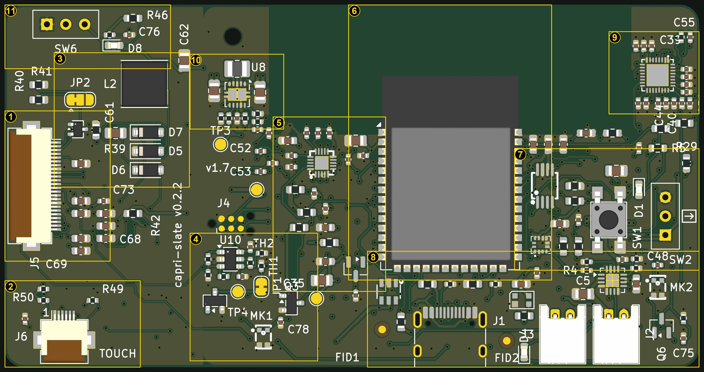
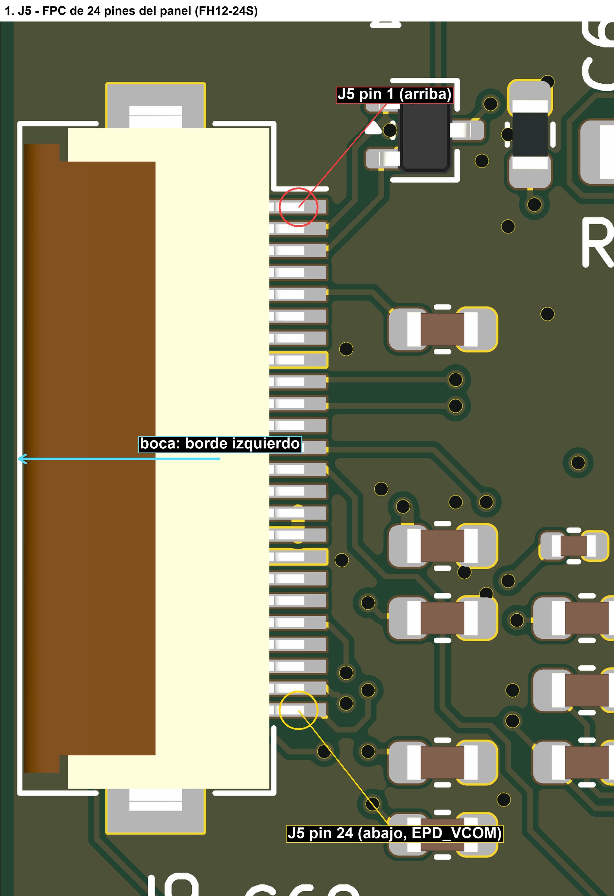
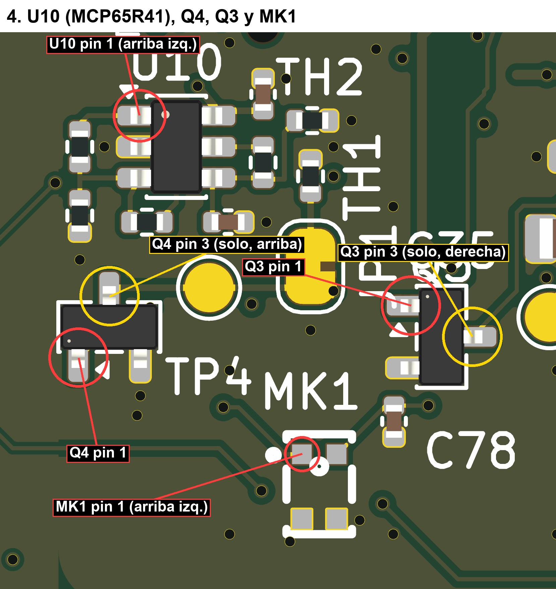
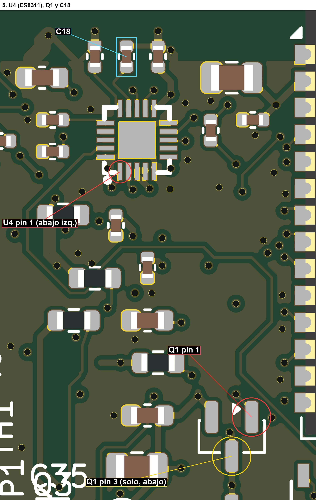
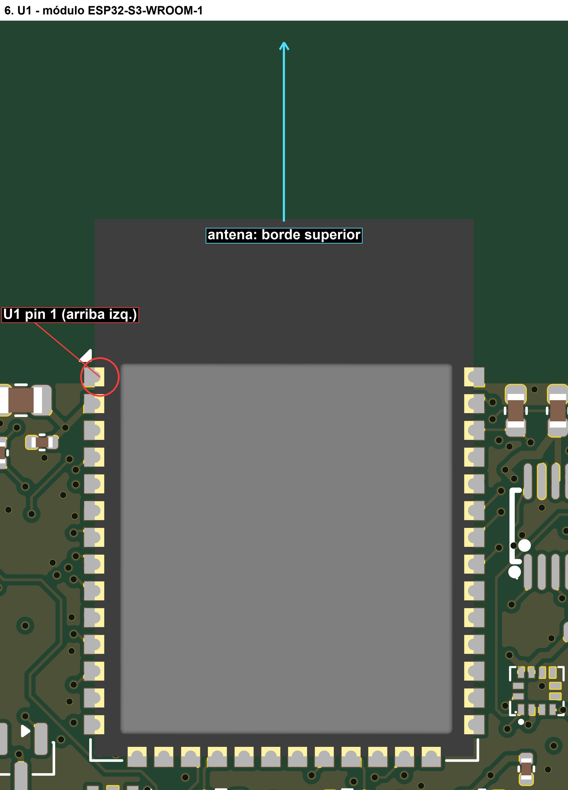
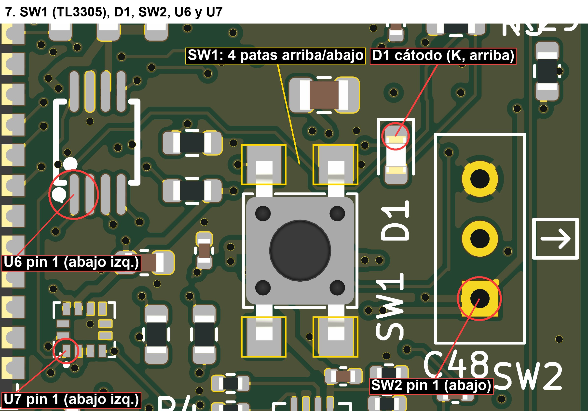

**What this is for.** Before you pay, JLCPCB shows a drawing of the board with every part placed (the "placement preview"). It is the only check that cannot be done from the files. This guide says, part by part, what **correct** looks like. If something does not match, do not pay: rotate the part in the JLCPCB editor, or leave the order in "Review Before Payment" and write to them.

**How to read the images.** They show the board from above, with the antenna (green area with no copper) at the top and the USB at the bottom. The marks come from the board file ([`../pcb/esp32-audio-module.kicad_pcb`](../pcb/esp32-audio-module.kicad_pcb)):

- **Red circle:** pin 1 of the part or, on diodes and LEDs, the **cathode (K)**. The pin 1 or polarity mark that JLCPCB draws has to land there.
- **Yellow circle:** another reference pin (the "single" pin of a transistor, the last pin of a connector).
- **Light blue arrow or box:** which way a connector's opening faces, or a part with no polarity.

The images are a KiCad render: the colors and shapes of the parts will not be the same as JLCPCB's; what has to match is **the position, the rotation and the pin 1 mark**. The render does not draw the body of SW2, SW6, J1 and the microphones; only their pads are visible.

The X, Y and rotation columns are those of [`../fab/CPL.csv`](../fab/CPL.csv) (mm from the bottom-left corner, Y up), so you can find the row in the JLCPCB table. If JLCPCB shows a different rotation in the table but the drawing matches this guide, the drawing wins.

# The three expensive mistakes

| # | What | Why it is expensive | How to spot it |
|---|---|---|---|
| 1 | **J5 or J6 rotated 180°** | The panel or the touch cannot be connected; they are 0.5 mm pitch connectors, hard to resolder | The fine contacts must face **the center** of the board and the opening **the edge** (J5: left edge; J6: bottom edge). If the opening faces inward, it is backwards |
| 2 | **D5, D6 or D7 reversed** | The e-ink panel voltages are not generated and the boost converter can be damaged | The stripe (cathode) of all three must be **on the left**, on the J5 side. All three the same |
| 3 | **U10 or a QFN (U2, U4, U8, U9) rotated** | The chip ends up connected to the wrong pins; it can heat up or fail to charge the battery | The pin 1 dot must land in the red circle: U10 top left; U2 top left; U4 bottom left; U8 and U9 top right |

# Zone by zone

## 1. J5, panel connector (24 pins)

{width=45%}

| Part | CPL X | CPL Y | Rotation | Correct |
|---|---:|---:|---:|---|
| **J5** FH12-24S-0.5SH, bottom contact | 5.205 | 24.000 | 90 | The 24 fine contacts face the center of the board (right) and the opening faces the **left edge**. Pin 1 is the **top** one (no connection); pin 2 is EPD_GDR; pin 24, the bottom one, is EPD_VCOM. The two mounting tabs sit at the top and bottom, on the edge side |

## 2. J6, touch connector (6 pins)

{width=70%}

| Part | CPL X | CPL Y | Rotation | Correct |
|---|---:|---:|---:|---|
| **J6** FH12-6S-0.5SH, bottom contact | 7.900 | 5.230 | 180 | The 6 fine contacts face the center of the board (up) and the opening faces the **bottom edge**. Pin 1 (GND) is the **left** one, next to the "1" on the silkscreen; pin 6 (TOUCH_SCL) on the right |

## 3. Panel diodes, Q5 and L2

{width=70%}

| Part | CPL X | CPL Y | Rotation | Correct |
|---|---:|---:|---:|---|
| **D7** MBR0530 | 19.000 | 31.100 | 0 | Cathode (stripe) on the **left** (net EPD_PREVGH); anode on the right (EPD_SW) |
| **D5** MBR0530 | 19.000 | 28.600 | 0 | Cathode on the **left** (GND); anode on the right (EPD_PUMP) |
| **D6** MBR0530 | 19.000 | 26.100 | 0 | Cathode on the **left** (EPD_PUMP); anode on the right (EPD_PREVGL) |
| **Q5** Si1308EDL, SOT-323 | 9.671 | 31.500 | 180 | Two leads on the left (pin 1 on top, EPD_GDR; pin 2 below) and the single lead (pin 3, EPD_SW) on the **right** |
| **L2** 10 µH, C79272 | 18.500 | 37.500 | 0 | No polarity. 6 × 6 mm square centered over its two pads (left and right) |

## 4. U10, Q4, Q3 and MK1

{width=75%}

| Part | CPL X | CPL Y | Rotation | Correct |
|---|---:|---:|---:|---|
| **U10** MCP65R41, SOT-23-6 | 29.900 | 14.300 | 270 | Leads on the left and right, three per side. Pin 1 (CHG_HOT) **top left**; pin 6 (VSYS) top right |
| **Q4** 2N7002, SOT-23 | 27.850 | 8.821 | 270 | Single lead (pin 3, CHG_TEMP) **on top**; two leads below, pin 1 (CHG_HOT) bottom left |
| **Q3** 2N7002, SOT-23 | 38.021 | 8.500 | 180 | Two leads on the left (pin 1 on top) and the single lead (pin 3, VBUS_SENSE) on the **right** |
| **MK1** ZTS6216 microphone | 34.265 | 3.925 | 0 | Pin 1 (output) **top left**; the two bottom pads are GND |

## 5. U4, Q1 and C18

{width=55%}

| Part | CPL X | CPL Y | Rotation | Correct |
|---|---:|---:|---:|---|
| **U4** ES8311, QFN-20 | 42.000 | 27.050 | 0 | Pin 1 (I2C_SCL) in the bottom row, the **leftmost** one (bottom-left corner) |
| **Q1** SI2301CDS, SOT-23 | 46.500 | 12.942 | 90 | Two leads on top (pin 1 on the **right**, pin 2 on the left) and the single lead (pin 3, AUDIO_3V3) **at the bottom** |
| **C18** 1 µF 0402 | 41.500 | 31.000 | 90 | No polarity; vertical, right above U4. It is one of the three 0402s with a via in the pad: check that it sits centered |

## 6. U1, ESP32 module

{width=60%}

| Part | CPL X | CPL Y | Rotation | Correct |
|---|---:|---:|---:|---|
| **U1** ESP32-S3-WROOM-1-N16R8 | 58.999 | 22.225 | 0 | The antenna (the part of the module without the metal can) toward the **top edge**, over the area with no copper. Pin 1 (GND) is the first one in the **left column, at the top**. The metal can faces the USB |

## 7. SW1, D1, SW2, U6 and U7

| Part | CPL X | CPL Y | Rotation | Correct |
|---|---:|---:|---:|---|
| **SW1** TL3305 (**UNVERIFIED** row in the CPL) | 80.000 | 19.500 | 90 | The four leads come out **toward the top and the bottom** and land on the four pads (two above, two below). If the leads come out to the sides, it is rotated 90° and has to be rotated. It is symmetric: 180° gives the same result |
| **D1** red LED 0603 | 84.000 | 23.500 | 270 | Vertical. Cathode **on top** (U2_STAT) |
| **SW2** SS12D00G6, through-hole | 87.500 | 20.000 | 90 | Three leads in a vertical line over its three holes, right against the right edge; pin 1 (square pad, VSYS) **at the bottom**. The body is symmetric: all that matters is that it is centered on the three holes |
| **U6** PAM8302, MSOP-8 | 71.555 | 24.000 | 0 | Leads on top and bottom. Pin 1 (PA_EN) **bottom left** |
| **U7** LIS2DH12, LGA-12 | 71.000 | 16.195 | 0 | Pin 1 (I2C_SCL) in the bottom row, **on the left** |

## 8. Bottom-right edge: J1, U5, D2, D4, J3, J2, U2, MK2 and Q6

| Part | CPL X | CPL Y | Rotation | Correct |
|---|---:|---:|---:|---|
| **J1** USB-C | 59.000 | 4.765 | 0 | Opening toward the **bottom edge**; the row of fine contacts toward the center of the board |
| **U5** USBLC6-2, SOT-23-6 | 50.860 | 10.000 | 180 | Leads on top and bottom. Pin 1 **top right** |
| **D2** WS2812B-2020 | 68.505 | 8.900 | 0 | Pin 1 (DOUT) **top left**; pin 3 (DIN, data input) bottom right; pin 4 (3V3) top right |
| **D4** green LED 0603 | 68.800 | 2.000 | 90 | Vertical. Cathode **at the bottom**, toward the edge (CHG_PGOOD) |
| **J3** JST-PH speaker, through-hole | 73.900 | 6.800 | 180 | Opening toward the **bottom edge**; pin 1 (SPK_P) on the left |
| **J2** JST-PH battery, through-hole | 81.000 | 6.795 | 180 | Opening toward the **bottom edge**; pin 1 (battery **positive**) on the **left**, pin 2 (GND) on the right |
| **U2** BQ24075, QFN-16 | 80.500 | 11.500 | 0 | Pin 1 (CHG_TEMP) in the left column, the **top** one (top-left corner) |
| **MK2** ZTS6216 microphone | 86.500 | 10.500 | 0 | Pin 1 (output) **top left** |
| **Q6** SI2301CDS, SOT-23 | 87.000 | 5.558 | 270 | Single lead (pin 3, MIC_VDD) **on top**; two leads below, pin 1 bottom left |

## 9. U9

{width=55%}

| Part | CPL X | CPL Y | Rotation | Correct |
|---|---:|---:|---:|---|
| **U9** ES7210, QFN-32 | 86.475 | 38.665 | 180 | Pin 1 in the top row, the **rightmost** one (top-right corner) |

## 10. U8

{width=55%}

| Part | CPL X | CPL Y | Rotation | Correct |
|---|---:|---:|---:|---|
| **U8** TPS63000, SON-10 | 30.800 | 36.105 | 270 | Leads on top and bottom, five per side. Pin 1 (3V3) in the top row, **on the right** |

## 11. SW6, D8 and C76

{width=80%}

| Part | CPL X | CPL Y | Rotation | Correct |
|---|---:|---:|---:|---|
| **SW6** SS12D00G6, through-hole | 8.100 | 45.400 | 0 | Three leads in a horizontal line over its three holes, next to the top edge; pin 1 (square pad, GND) on the **left**. Symmetric body, same as SW2 |
| **D8** green LED 0603 | 14.500 | 42.600 | 0 | Horizontal. Cathode on the **left** (MIC_EN_N) |
| **C76** 10 nF 0402 | 16.500 | 44.000 | 0 | No polarity; with a via in the pad: check that it sits centered |

The third 0402 with a via in the pad is **C73** (100 nF, CPL 13.100 / 22.000 / 0), to the right of J5, level with its pins 15 to 17; it is visible in the zone 1 image.

# Also, on the same screen

- That J2, J3, SW2 and SW6 (through-hole) show up as **placed** and not as "not mounted": JLCPCB solders them by hand.
- That no part is listed as out of stock or substituted. The ones with short stock: U10 (C219181), SW1 (C2886899) and SW2/SW6 (C50377150).
- That "Via Covering" says **Epoxy Filled & Capped**.

# Purchases to lower the risk

Cheap compared with the cost of repeating the order. Codes, stock and price from JLCPCB's public API on 2026-11-12 (responses in `evidence/jlcpcb-purchases-2026-11-12.json`); they are LCSC codes and are bought at lcsc.com, where the stock and the minimum multiple may differ. Quantities for 5 boards.

| What for | Part | Code | Qty | USD each | Stock |
|---|---|---|---:|---:|---:|
| If the panel has its contacts on the opposite side from J5's: swap the connector by hand | Hirose **FH12A-24S-0.5SH(55)**, top contact, 24 pins | C506794 | 6 | 0.83 | 1605 |
| The same for J6 | A 6-pin FH12A **does not exist** (see below): it is solved with a cable and a coupler | - | - | - | - |
| Flat cable, 6 pins, 0.5 mm, same side (type A), 12 cm | Kinghelm KH-FFC-A0.5-6P-120MM | C5124687 | 10 | 0.08 | 90 |
| Flat cable, 6 pins, 0.5 mm, opposite sides (type B), 15 cm | LX "6P 0.5 mm 15CM Inverting" | C61064 | 10 | 0.08 | 1185 |
| Flat cable, 24 pins, 0.5 mm, same side (type A), 12 cm | LX "24P 0.5 mm 12CM Same Side" | C36268 | 10 | 0.06 | 645 |
| Flat cable, 24 pins, 0.5 mm, opposite sides (type B), 12 cm | LX "24P 0.5 mm 12CM Inverting" (alternative: Kinghelm 10 cm, C2859436, US$0.20, stock 100) | C24318 | 10 | 0.06 | 47 |
| FFC/FPC 0.5 mm couplers or extenders (small board with two connectors), 6 and 24 pins | Generic, no LCSC code | - | 6 + 6 | 1 to 2 | - |
| Adapter boards, FPC 0.5 mm to 2.54 mm pins, 6 and 24 pins | Generic, no LCSC code | - | 4 + 4 | 1 to 2 | - |
| If the panel boost converter misbehaves with 10 µH: go back to the previous value of L2 | Sunlord SWPA6045S680MT, **68 µH** | C53663 | 10 | 0.09 | 18883 |
| Spare for C18 (0402 with a via in the pad) | 1 µF 25 V X5R 0402, CL05A105KA5NQNC | C52923 | 20 | 0.006 | 10.7 M |
| Spare for C73 (same) | 100 nF 50 V X7R 0402, CL05B104KB54PNC | C307331 | 20 | 0.009 | 20.3 M |
| Spare for C76 (same) | 10 nF 50 V X7R 0402, CL05B103KB5NNNC | C15195 | 20 | 0.004 | 4.5 M |
| If not bought yet | **GDEY075T7-T01** panel (5, one per board) and **Waveshare 13512** driver board (1, to test the panel without the board) | - | 5 + 1 | not quoted | - |

**Approximate total, without panel or driver board:** parts with a code, about **US$10**; generic couplers and adapters, **US$15 to 30**; LCSC shipping to Lima, not quoted (it usually costs more than the parts). Altogether, on the order of **US$40 to 60**.

**What was verified and what was not:**

- The Hirose catalog for the FH12 series (2016-11-01 edition, the one LCSC publishes for C202118 and C506794; page 11) gives **a single pad table** for "0.5mm Pitch Bottom Contact Type" and "0.5mm Pitch Top Contact Type". The FH12A-24S-0.5SH therefore fits the J5 pads and keeps the pin order; only the contact side changes.
- The same catalog lists the FH12A-xxS-0.5SH only from **10 to 50 pins**: there is no 6-pin top-contact version, and the JLCPCB API returns no "FH12A-6S". For J6 the fix is a type B cable or a coupler, not swapping the connector. A 6-pin connector from another brand was not verified against the footprint.
- A type A or B cable plus a coupler lets you choose the contact side without soldering. Two 2.54 mm adapters with Dupont wires also let you change the pin order (practical with 6 pins; with 24 only for a bench test). They are also the parts the dock needs to bring the panel tails to the board; the final lengths depend on the actual panel.
- **Not verified: SW1.** The footprint joins the two left pads (signal) and the two right pads (GND). If the TL3305 joined its leads internally in a different way, the button would be permanently pressed; that cannot be seen in the preview. Measure continuity on the first board.
- The actual contact side of the two tails of the GDEY075T7-T01 panel is still unconfirmed: the panel is needed.

*The images come from the board file; the annotations mark pin 1 and polarity.*
